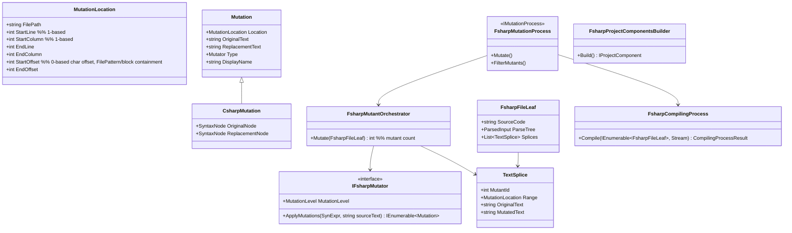

# fsharp-support — Tasks

Design: [DESIGN.md](./DESIGN.md)

## Analysis

Build: `dotnet build src/Stryker.slnx -c Debug` — baseline run at pre-flight
Test: `dotnet test src/Stryker.vstest.slnf -c Debug` — baseline run at pre-flight
MTP tests: `dotnet test -c Debug` run from `src/Stryker.TestRunner.MicrosoftTestPlatform.UnitTest` (own global.json)
Integration: `pwsh ./integration-tests.ps1` (packs CLI 0.0.0-localdev, runs category via env `CATEGORY`/`RUNTIME`, validates with the ValidationProject)
Lint: `.editorconfig` enforced by build; no separate lint command

**WSL note**: use the Linux `dotnet` (`/usr/bin/dotnet`, SDK 10.0.114). Do not mix with
Windows `dotnet.exe` on this checkout — each OS rewrites `obj/` restore artifacts.
Lock files: restore runs with `RestorePackagesWithLockFile`; new projects need
`packages.lock.json` generated (`dotnet restore --force-evaluate` unlocked) or CI restore fails.

### Known-failing tests

Baseline (pre-flight, Linux dotnet): `Stryker.Core.UnitTest` 1625/1641, 1 failed,
15 skipped (Windows-only); all other projects green.

| Test | Reason | Action |
|---|---|---|
| `MarkdownSummaryReporter_ShouldOutputSummaryLocationToTheConsole` | Spectre.Console green-span count 3 vs 2 — terminal-dependent console rendering, pre-existing | ignore; any *other* failure name = regression |

### Domain model

### Requirement traceability

| Type / Fn | Stability | Addresses | Notes |
|---|---|---|---|
| `MutationLocation` | published | [FR5](./DESIGN.md#fr5) | in `Stryker.Abstractions` (NuGet-published) — additive only; task 3 added `StartOffset`/`EndOffset` (char offsets) for `FilePattern` and block-containment matching |
| `Mutation` (neutral fields) | published | [FR5](./DESIGN.md#fr5), [FR7](./DESIGN.md#fr7) | [ADR](./adrs/mutation-location-abstraction.md); additive, then `OriginalNode` moves to `CsharpMutation` (breaking for `Stryker.Abstractions` consumers — release-noted) |
| `CsharpMutation` | published | [FR7](./DESIGN.md#fr7) | carries Roslyn nodes for C#-only filters |
| `TextSplice` | internal | [FR2](./DESIGN.md#fr2), [FR3](./DESIGN.md#fr3) | [ADR](./adrs/mutation-mechanism.md) |
| `FsharpFileLeaf`, `FsharpFolderComposite` | internal | [FR1](./DESIGN.md#fr1) | mirrors `CsharpFileLeaf` |
| `FsharpProjectComponentsBuilder` | internal | [FR1](./DESIGN.md#fr1), [NFR3](./DESIGN.md#nfr3) | compile-item order from Buildalyzer |
| `IFsharpMutator` + mutators | internal | [FR6](./DESIGN.md#fr6) | text-returning mutator API |
| `FsharpMutantOrchestrator` | internal | [FR2](./DESIGN.md#fr2) | walks FCS untyped AST, emits splices |
| `FsharpCompilingProcess` | internal | [FR2](./DESIGN.md#fr2), [FR3](./DESIGN.md#fr3) | [ADR](./adrs/compile-strategy.md); encapsulates A/B choice |
| `FsharpMutationProcess` | internal | [FR1](./DESIGN.md#fr1) | implements existing `IMutationProcess` |
| `Stryker.Fsharp` project/package | published | [NFR1](./DESIGN.md#nfr1) | [ADR](./adrs/fsharp-compiler-dependency.md); only home of FCS |

### Transformations

| Function | Input → Output | Invariant / Rule |
|---|---|---|
| `Roslyn→MutationLocation` | `FileLinePositionSpan (0-based) → MutationLocation (1-based)` | +1 exactly once, centralised (today in `Reporters/Json/Location.cs:18-28`) |
| `FCS range→MutationLocation` | `FSharp.Compiler.Text.Range → MutationLocation` | FCS lines are 1-based, columns 0-based → column +1 here only |
| `IFsharpMutator.ApplyMutations` | `SynExpr + source text → Mutation list` | replacement text compiles standalone when parenthesised; original text = exact source slice |
| `Orchestrator.Mutate` | `FsharpFileLeaf → splices + Mutant list` | unique mutant id per splice; splice = `(if <ns>.MutantControl.IsActive <id> then <mutated> else <original>)`, always parenthesised |
| `ApplySplices` | `(source, splices) → mutated source` | applied right-to-left, inner-first per file (ranges stay valid); non-spliced text byte-identical |
| `Compile` | `mutated leaves → Result<asm bytes, FSharpDiagnostic list>` | file order = `.fsproj` compile-item order ([NFR3](./DESIGN.md#nfr3)); signing/resources honoured |
| `Rollback` (error path) | `FSharpDiagnostic list → BuildError mutant ids` | every error diag maps range→splice id; unmapped → drop whole file's mutants; still failing → fail run with diagnostics (DESIGN failure modes) |
| `BuildSourceProjectInfo` (error path) | `.fsproj with no compile items → InputException` | clean message naming the project, never `NotSupportedException` |

## Tasks

### 1. F# project fails cleanly instead of crashing ([FR7](./DESIGN.md#fr7))
**Goal**: Running Stryker on an F# project today gives an unhandled `NotSupportedException`; it must exit with a user-facing `InputException` until real support lands (gate removed in task 8).
**Slice**: clean error for F# source project, end to end (resolver → CLI exit, test)
**Fit**: closed
**Types**: none new
**Constraints**:
- `MutableProjectTarget.cs:62-67` throws `InputException` ("F# support is experimental / not yet enabled…") instead of `NotSupportedException`
- `Program.cs` already renders `InputException` cleanly — no CLI change
**Tests**:
- `BuildSourceProjectInfo_FsharpProject_ThrowsInputException_WithProjectPath` — unit, `InputFileResolverTests` style
**Verify**: `dotnet test src/Stryker.Core/Stryker.Core.UnitTest -c Debug --filter FullyQualifiedName~InputFileResolver`
**Acceptance criteria**:
- [x] F# source project → `InputException` naming the project path
- [x] Message no longer claims "not supported", points at experimental status
**Depends on**: (none)
**Time-box**: ~30 min

### 2. Expand: neutral location fields on `Mutation` ([FR5](./DESIGN.md#fr5), [NFR2](./DESIGN.md#nfr2))
**Goal**: `MutationLocation` exists; `Mutation` gains `Location`, `OriginalText`, `ReplacementText`, filled by every C# mutation at construction, alongside the Roslyn nodes.
**Slice**: expand
**Fit**: closed
**Types**: `MutationLocation`, `Mutation` (neutral fields) — see domain model
**Constraints**:
- [ADR mutation-location-abstraction](./adrs/mutation-location-abstraction.md) — Option A
- Additive only in this task: `OriginalNode`/`ReplacementNode` untouched, no consumer changes
- 0-based→1-based conversion in one place (`Roslyn→MutationLocation` transformation); C# fills neutral fields in the `Mutation` constructor path used by `MutatorBase.Mutate`
**Tests**:
- `MutationLocation_FromRoslynSpan_Is1Based` — span (0,0) → line 1, column 1
- `CsharpMutation_NeutralFields_MatchRoslynNodeLocationAndText`
**Verify**: `dotnet test src/Stryker.vstest.slnf -c Debug`
**Acceptance criteria**:
- [x] Every C#-produced `Mutation` has non-null `Location`, `OriginalText`, `ReplacementText`
- [x] Full unit suite green
**Depends on**: (none)
**Time-box**: ~75 min

### 3. Migrate: consumers read neutral fields ([FR5](./DESIGN.md#fr5), [NFR2](./DESIGN.md#nfr2))
**Goal**: Reporters, span filters, and baseline matching read `Mutation.Location`/texts instead of Roslyn nodes.
**Slice**: migrate (one batch — 6 sites)
**Fit**: closed
**Types**: none new
**Constraints**:
- Sites: `JsonMutant.cs:39`, `Location.cs:18-28`, `ClearTextTreeReporter.cs:87`, `FilePatternMutantFilter.cs:43-49`, `IgnoreBlockMutantFilter.cs:33`, `BaselineMutantHelper.cs:16,30`
- Observable no-op for C#: existing reporter/filter/baseline suites are the guard ([NFR2](./DESIGN.md#nfr2))
**Tests**:
- `JsonMutant_UsesNeutralLocation` — JsonReporter test without a Roslyn fixture
- existing suites green
**Verify**: `dotnet test src/Stryker.vstest.slnf -c Debug`
**Acceptance criteria**:
- [x] None of the 6 sites references `SyntaxNode`
- [x] Zero mutant-count/report behaviour change (suite green)
**Depends on**: task 2
**Time-box**: ~75 min

### 4. Contract: Roslyn nodes move to `CsharpMutation` ([FR7](./DESIGN.md#fr7), [NFR2](./DESIGN.md#nfr2))
**Goal**: Base `Mutation` no longer exposes `SyntaxNode`; C# mutators construct `CsharpMutation`; tree-walking filters cast and skip non-C# mutants with a one-time debug log.
**Slice**: contract
**Fit**: closed
**Types**: `CsharpMutation : Mutation`
**Constraints**:
- Tree-walking filters (`IgnoredMethodMutantFilter.cs:26`, `ExcludeLinqExpressionFilter.cs:24`, `ExcludeFromCodeCoverageFilter.cs:19`) cast to `CsharpMutation`; cast failure → do not filter, log debug once ([FR7](./DESIGN.md#fr7))
- `CSharpRollbackProcess` and `MutantPlacer` keep node access via `CsharpMutation`
- Breaking `Stryker.Abstractions` change — note for release notes in task 16
**Tests**:
- `IgnoredMethodFilter_NonCsharpMutation_IsNotFiltered`
- existing suites green
**Verify**: `dotnet test src/Stryker.vstest.slnf -c Debug`
**Acceptance criteria**:
- [x] `Mutation` (base) has no Roslyn member
- [x] Full unit suite green
**Depends on**: task 3
**Time-box**: ~60 min

### 5. `Stryker.Fsharp` package skeleton behind a language dispatch seam ([NFR1](./DESIGN.md#nfr1))
**Goal**: A new `src/Stryker.Fsharp` project (FCS pinned latest stable, lock file) plugs into the two switch points; `Stryker.Core` has no FCS reference; vulnerability gate green.
**Slice**: prefactoring — dispatch + package boundary tasks 6-9 build on
**Fit**: closed
**Types**: `Stryker.Fsharp` project; keyed `IMutationProcess`/components-builder resolution by `Language`; stub `FsharpMutationProcess`
**Constraints**:
- [ADR fsharp-compiler-dependency](./adrs/fsharp-compiler-dependency.md) — FCS only in `Stryker.Fsharp`
- Switch points: `MutableProjectTarget.cs:62-67`, `ServiceCollectionExtensions.cs:31` (keyed DI by `Language`)
- `FSharp.Compiler.Service` added to `src/Directory.Packages.props`; `packages.lock.json` generated for every affected project; new `Stryker.Fsharp.UnitTest` project mirrors `Stryker.Core.UnitTest` layout and joins `Stryker.slnx` + `Stryker.vstest.slnf`
- Nuget packaging of the new assembly follows how `Stryker.Core` ships inside the CLI tool (same `.csproj` packaging pattern)
**Tests**:
- `ServiceProvider_FsharpProject_ResolvesFsharpMutationProcess` — DI resolution test
- `ServiceProvider_CsharpProject_ResolvesCsharpMutationProcess` — regression guard
**Verify**: `dotnet build src/Stryker.slnx -c Debug && dotnet list src/Stryker.slnx package --vulnerable --include-transitive`
**Acceptance criteria**:
- [x] `Stryker.Core.csproj` has no FCS reference (direct or transitive)
- [x] Vulnerability scan reports nothing
**Depends on**: task 1
**Time-box**: ~90 min

### 6. F# component tree in compile order ([FR1](./DESIGN.md#fr1), [NFR3](./DESIGN.md#nfr3))
**Goal**: `FsharpProjectComponentsBuilder` builds `FsharpFileLeaf` components from the analyzer result's compile items, in `.fsproj` order, each parsed with one shared `FSharpChecker` using project (not script) options.
**Slice**: F# project resolves to a populated component tree (resolver → leaves, test)
**Fit**: closed
**Types**: `FsharpFileLeaf`, `FsharpFolderComposite`, `FsharpProjectComponentsBuilder`
**Constraints**:
- File set + order from `IAnalyzerResult` compile items — never directory scans ([NFR3](./DESIGN.md#nfr3))
- Base-class members `CompilationSyntaxTrees`/`MutatedSyntaxTrees` (`ProjectComponent.cs:58-67`): F# leaves return empty — do not generalise the base class in this task
- Unparseable file on unmutated source → warn + skip leaf (DESIGN failure modes); `.fsi`/`.fsx` items excluded with a debug log (non-goal)
**Tests**:
- `FsharpComponentsBuilder_BuildsLeaves_InCompileItemOrder` — MockFileSystem, shuffled directory order vs ordered compile items
- `FsharpComponentsBuilder_SkipsUnparseableFile_WithWarning`
**Verify**: `dotnet test src/Stryker.Fsharp.UnitTest -c Debug`
**Acceptance criteria**:
- [x] Leaves ordered exactly as compile items
- [x] Each leaf has `SourceCode` + `ParseTree` populated
**Depends on**: task 5
**Time-box**: ~90 min

### 7. Compile step: unmutated F# project compiles and its tests run ([FR2](./DESIGN.md#fr2), [NFR3](./DESIGN.md#nfr3))
**Goal**: `FsharpCompilingProcess` compiles the (unmutated) leaves into an assembly that overwrites the test output (with `.stryker-unchanged` backup) and the project's own tests pass against it — the compile-strategy spike, landed as working code.
**Slice**: whole — a compile step has no partial observable below "the produced assembly loads and tests pass"
**Fit**: closed
**Types**: `FsharpCompilingProcess`
**Constraints**:
- [ADR compile-strategy](./adrs/compile-strategy.md): Option A (fsc args from Buildalyzer + FCS compile). If A is not green by the time-box, switch to Option B (shadow-copy `dotnet build`) inside `FsharpCompilingProcess` and append the outcome to the ADR Consequences — no other seam changes
- Overwrite path + backup semantics identical to C# (`TestProjectsInfo.cs:41-89`, `CsharpMutationProcess.cs:65-95`)
- Signing/resources honoured when the project defines them (assert via integration project later; here: assembly name/version match)
**Tests**:
- `FsharpCompile_UnmutatedProject_ProducesLoadableAssembly` — temp project fixture
- `FsharpCompile_OverwritesTestOutput_AndBackupExists`
**Verify**: `dotnet test src/Stryker.Fsharp.UnitTest -c Debug`
**Acceptance criteria**:
- [x] Compiled assembly has same name/version as original and loads
- [x] Backup file present; restore returns the original
**Depends on**: task 6
**Time-box**: ~90 min (hard cap: fallback to Option B inside it)

### 8. Walking skeleton: one boolean mutant killed, end to end ([FR1](./DESIGN.md#fr1), [FR2](./DESIGN.md#fr2), [FR5](./DESIGN.md#fr5), [FR6](./DESIGN.md#fr6))
**Goal**: Stryker on a one-file F# library with an F# xunit test project reports one boolean-literal mutant as Killed: orchestrate → splice → compile → helper → VsTest → JSON report.
**Slice**: whole — a mutant that isn't compiled and tested reports nothing; tasks 2-7 isolated every piece
**Fit**: closed
**Types**: `BooleanMutator` (F#), `IFsharpMutator`, `FsharpMutantOrchestrator`, `TextSplice`; `FsharpMutationProcess` goes from stub to real
**Constraints**:
- [ADR mutation-mechanism](./adrs/mutation-mechanism.md): splice `(if <ns>.MutantControl.IsActive <id> then <m> else <o>)`, always parenthesised
- Orchestrator never descends into `SynExpr.Quote` subtrees (`<@ … @>`) — an injected `IsActive` call would surface in the expression tree ([FR7](./DESIGN.md#fr7)); covered by `Orchestrator_Quotation_YieldsNoMutants`
- Helper: compile existing C# `MutantControl`/`MutantContext` sources (randomised namespace from `CodeInjection`) with Roslyn into `<ns>.StrykerHelpers.dll`, write next to test output, reference it in the F# compile — runners' reflection contract unchanged (`CoverageCollector.cs:146-167`)
- Report: `SourceFile.Language = "fs"` for F# leaves (`SourceFile.cs:26-27`), spans from `MutationLocation` ([FR5](./DESIGN.md#fr5))
- Task 1's `InputException` gate removed here
**Tests**:
- `BooleanMutator_TrueLiteral_YieldsFalseReplacement` — unit
- `Orchestrator_SplicesSingleMutant_ParenthesisedWithId` — unit, exact spliced text
- `Orchestrator_Quotation_YieldsNoMutants` — unit, `<@ true @>` produces zero mutants
- `FsharpSkeleton_EndToEnd_ReportsKilledMutant` — drives `MutationTestProcess` on a temp F# project (pattern: `ProjectOrchestratorTests`)
**Verify**: `dotnet test src/Stryker.Fsharp.UnitTest -c Debug && dotnet test src/Stryker.vstest.slnf -c Debug`
**Acceptance criteria**:
- [ ] JSON report: 1 mutant, status Killed, `language: "fs"`, 1-based span matching the literal
- [x] Original assembly restored after the run

**Delta (task 8)**: `FsharpSkeleton_EndToEnd_ReportsKilledMutant` runs the real orchestrate, splice, helper compile, F# compile and injection through `FsharpMutationProcess.Mutate`, loads the mutated assembly and flips the result via `<ns>.MutantControl.ActiveMutant`; the `SourceFile`/`JsonMutant` fragment has `language: "fs"` and the 1-based span. The Killed status is set by a simulated failing test, not by a VsTest run (no F# xunit packages offline, so the first box stays open until the task 16 integration target). Found while probing: hosts with a `*.deps.json` only load listed assemblies, so the helper dll is also registered in the test output's deps files (`RegisterInDependencyManifests`). The gate in `MutableProjectTarget` now throws only when no builder is registered for the language; `ProjectMutator` resolves the keyed `IMutationProcess` for non-C# projects. Mutant filters are not applied to F# yet (TODO in `FsharpMutationProcess`).
**Depends on**: tasks 4, 7
**Time-box**: ~90 min

### 9. Compile-error rollback ([FR3](./DESIGN.md#fr3))
**Goal**: A mutant producing non-compiling F# (e.g. `+`→`-` on strings) becomes `BuildError`; the run completes with the remaining mutants tested.
**Slice**: broken mutant → BuildError in report, end to end (compile → rollback → report, test)
**Fit**: closed
**Types**: splice map (`file + range → mutant id`) inside `FsharpCompilingProcess`
**Constraints**:
- Map `FSharpDiagnostic.Range` → enclosing splice; re-apply without the guilty splices; retry ≤ 50 with Normal→Aggressive→LastChance escalation mirroring `CsharpCompilingProcess.cs:114-145`
- Unmapped error diagnostic → drop all mutants of that file; still failing → fail run quoting diagnostics (DESIGN failure modes)
- Rolled-back ids → `BuildError` as in `CsharpMutationProcess.cs:98-105`
**Tests**:
- `Rollback_DiagnosticInsideSplice_MarksMutantBuildError`
- `Rollback_UnmappedDiagnostic_DropsFileMutants`
- `Rollback_AlwaysFailingSplice_BoundedRetries`
**Verify**: `dotnet test src/Stryker.Fsharp.UnitTest -c Debug`
**Acceptance criteria**:
- [x] Report: BuildError for the broken mutant, Killed/Survived for the rest
- [x] Retry bound proven by the always-failing test
**Depends on**: task 8
**Time-box**: ~90 min

### 10. Nested and multi-mutant splicing ([FR2](./DESIGN.md#fr2))
**Goal**: Many mutants per file, including a mutant inside another mutant's expression, splice into one compilable source.
**Slice**: two overlapping mutants → both selectable, exact mutated text (orchestrator → splice, test)
**Fit**: closed
**Types**: none new
**Constraints**:
- Inner-first, right-to-left application (`ApplySplices` transformation invariant); exact-text assertion required
**Tests**:
- `Orchestrator_NestedMutants_SpliceInnerFirst_ExactText`
- `Orchestrator_ManyMutantsOneFile_SingleCompileSucceeds`
**Verify**: `dotnet test src/Stryker.Fsharp.UnitTest -c Debug`
**Acceptance criteria**:
- [x] Exact spliced text matches the specified nesting form
- [x] One compilation carries all mutants
**Depends on**: task 8
**Time-box**: ~60 min

### 11. Per-test coverage + static bindings ([FR4](./DESIGN.md#fr4))
**Goal**: `--coverage-analysis perTest` prunes uncovered F# mutants to NoCoverage; module-level `let` bindings (static init) are tracked so `coveredInStatic` fills.
**Slice**: two mutants, one covered one not → one tested, one NoCoverage (coverage → test selection, test)
**Fit**: closed
**Types**: none new
**Constraints**:
- No runner changes — contract is the compiled helper type + env vars (analysis verdict, `CoverageCollector.cs:146-167`)
- Module-level `let` values: wrap the spliced expression in the `MutantContext.TrackValue` equivalent (`MutantContext.cs:10-33`); if the expression form cannot be wrapped, mark those mutants static as C#'s static marker semantics do
**Tests**:
- `FsharpCoverage_PerTest_UncoveredMutantIsNoCoverage` — e2e-style as task 8's
- `FsharpModuleValue_Mutant_DetectedAsStatic`
**Verify**: `dotnet test src/Stryker.Fsharp.UnitTest -c Debug`
**Acceptance criteria**:
- [x] Uncovered mutant ends NoCoverage, covered one Killed/Survived
- [x] Module-value mutant flagged static (or tracked) — assertion on mutant metadata
- Delta: the NoCoverage proof drives the real helper (`CaptureCoverage`/`GetCoverageData`) and the runner-agnostic `CoverageAnalyser` with a mocked `ITestRunner`. The covered mutant stays Pending (to be tested), Killed/Survived needs the live runner: task 16.
- Delta: module values are both flagged `IsStaticValue` and wrapped in a public `StaticValueTracker.Track` (helper-side shim over the internal `MutantContext.TrackValue`).
**Depends on**: task 8
**Time-box**: ~90 min

### 12. Arithmetic operator mutator ([FR6](./DESIGN.md#fr6))
**Goal**: `+ - * / %` mutate pairwise on F# expressions via `IFsharpMutator`, honouring `MutationLevel`.
**Slice**: arithmetic mutants appear and are tested, end to end through the report count
**Fit**: closed
**Types**: `ArithmeticOperatorMutator` (F#)
**Constraints**:
- F# operators are `SynExpr.App` chains with idents `op_Addition` etc. — match the operator ident, replace the operator token text only
- `MutationLevel` mapping copies the C# equivalent ([docs/mutations.md](../../mutations.md))
- String `+` becoming `-` will not compile — rollback (task 9) handles it; no type-checking pass (DESIGN rabbit hole)
**Tests**:
- `ArithmeticMutator_Addition_YieldsSubtraction` (+ pairwise cases) — exact-text units
- `ArithmeticMutator_ReportCount_OnFixtureFile` — count asserted
**Verify**: `dotnet test src/Stryker.Fsharp.UnitTest -c Debug`
**Acceptance criteria**:
- [x] Pairwise replacements exact; fixture count matches
**Depends on**: tasks 9, 10
**Time-box**: ~60 min

### 13. Equality/comparison operator mutator ([FR6](./DESIGN.md#fr6))
**Goal**: `= <> < <= > >=` mutate per the C# equality table via `IFsharpMutator`.
**Slice**: equality mutants appear and are tested, end to end through the report count
**Fit**: closed
**Types**: `EqualityOperatorMutator` (F#)
**Constraints**:
- Same `SynExpr.App`/operator-ident matching as task 12; mapping per [docs/mutations.md](../../mutations.md)
**Tests**:
- `EqualityMutator_Equals_YieldsNotEquals` (+ table cases) — exact-text units
- `EqualityMutator_ReportCount_OnFixtureFile`
**Verify**: `dotnet test src/Stryker.Fsharp.UnitTest -c Debug`
**Acceptance criteria**:
- [x] Table replacements exact; fixture count matches
**Depends on**: task 12
**Time-box**: ~45 min

### 14. String literal mutator ([FR6](./DESIGN.md#fr6))
**Goal**: String literals mutate (`""`↔`"Stryker was here!"`), skipping compile-time-constant positions.
**Slice**: string mutants appear and are tested, end to end through the report count
**Fit**: closed
**Types**: `StringLiteralMutator` (F#)
**Constraints**:
- Skip `[<Literal>]` bindings and attribute arguments (compile-time constants — don't burn rollback retries)
- Interpolated/triple-quoted strings: mutate the whole literal or skip — never partial splice inside quotes
**Tests**:
- `StringMutator_NonEmptyLiteral_YieldsEmpty` / `StringMutator_EmptyLiteral_YieldsStrykerWasHere`
- `StringMutator_LiteralAttribute_IsSkipped`
**Verify**: `dotnet test src/Stryker.Fsharp.UnitTest -c Debug`
**Acceptance criteria**:
- [ ] Literal cases exact; `[<Literal>]` untouched
**Depends on**: task 12
**Time-box**: ~60 min

### 15. Collection function mutator ([FR6](./DESIGN.md#fr6))
**Goal**: `Seq`/`List`/`Array` module calls mutate as the F# analogue of the C# LINQ mutator (`l.Select(x => x)` ≡ `l |> Seq.map (fun x -> x)`).
**Slice**: collection-function mutants appear and are tested, end to end through the report count
**Fit**: closed
**Types**: `CollectionFunctionMutator` (F#)
**Constraints**:
- Match long idents `Seq.head`, `List.min`, … (`SynExpr.App` over `SynExpr.LongIdent`); replace the function-name text only
- Mapping: the [docs/mutations.md](../../mutations.md) linq table where an F# module function equivalent exists — at least `min`↔`max`, `head`↔`last`, `sortBy`↔`sortByDescending`, `sort`↔`sortDescending`, `tryHead`↔`tryLast`, each for `Seq`/`List`/`Array`; pairs without an equivalent are skipped
- C#-style extension-method LINQ on F# code (`l.Select(...)`) is out of scope — log once at debug
- `MutationLevel` copies the C# linq mutator's level
**Tests**:
- `CollectionMutator_SeqHead_YieldsSeqLast` (+ table cases across Seq/List/Array) — exact-text units
- `CollectionMutator_ReportCount_OnFixtureFile`
**Verify**: `dotnet test src/Stryker.Fsharp.UnitTest -c Debug`
**Acceptance criteria**:
- [ ] Table replacements exact for all three modules; fixture count matches
- [ ] Unmapped functions untouched
**Depends on**: task 12
**Time-box**: ~60 min

### 16. F# integration target + CI ([FR1](./DESIGN.md#fr1), [NFR2](./DESIGN.md#nfr2), [NFR3](./DESIGN.md#nfr3))
**Goal**: A real F# target project (two order-dependent files, F# xunit tests) runs in the integration matrix with exact mutant counts.
**Slice**: whole — project + script case + validation fact + matrix entry only mean anything together
**Fit**: closed
**Types**: `integrationtest/TargetProjects/NetCore/FsharpTargetProject` (+ F# xunit test project, `stryker-config.json`)
**Constraints**:
- Steps from analysis: `Run-Category` case in `integration-tests.ps1:87-200`; `[Fact]` with `Category`/`Runtime` traits + `CheckReportMutants` in `ValidateStrykerResults.cs`; matrix entry + excludes in `.github/workflows/integration-test.yaml:20-45`; `packages.lock.json` for new projects
- B.fs depends on A.fs ([NFR3](./DESIGN.md#nfr3)); counts pinned exactly as C# facts do (`ValidateStrykerResults.cs:84-85`)
**Tests**: the validation `[Fact]` itself
**Verify**: `CATEGORY=fsharp RUNTIME=netcore pwsh ./integration-tests.ps1`
**Acceptance criteria**:
- [ ] Integration run green locally with pinned counts
- [ ] Existing C# categories' counts unchanged ([NFR2](./DESIGN.md#nfr2))
**Depends on**: tasks 11, 13, 14, 15
**Time-box**: ~90 min

### 17. Docs + upstream proposal ([FR1](./DESIGN.md#fr1))
**Goal**: User docs mark F# support experimental with the supported mutator list; a maintainer-facing summary (removal reason answered: NFR1 gate + package isolation; `Stryker.Abstractions` breaking change noted) is drafted for a GitHub discussion.
**Slice**: whole — documentation
**Fit**: closed
**Types**: none
**Constraints**:
- New docs page docs/fsharp.md (experimental banner) + note on the configuration page; follow the markdown instructions file
- PR title: `feat(fsharp): add experimental F# mutation support` (squash-merge convention)
- Draft, do not post, the upstream discussion text (outward-facing — human sends it)
**Tests**: n/a — `manual: documentation`
**Verify**: `manual: review docs render`
**Acceptance criteria**:
- [ ] Docs updated; discussion draft saved in the workspace
**Depends on**: task 16
**Time-box**: ~60 min

## Sessions

### Session 1 — Seams: clean error + neutral Mutation (~4 h)
Tasks: 1, 2, 3, 4
**Skills**: `software-engineer`, `tdd`
**Checkpoint**: `dotnet test src/Stryker.vstest.slnf -c Debug`
**Commit point**: yes — one commit per task

### Session 2 — Package + component tree (~3 h)
Tasks: 5, 6
**Skills**: `software-engineer`, `tdd`
**Checkpoint**: `dotnet test src/Stryker.Fsharp.UnitTest -c Debug && dotnet list src/Stryker.slnx package --vulnerable --include-transitive`
**Commit point**: yes

### Session 3 — Compile + walking skeleton (~3 h)
Tasks: 7, 8
**Skills**: `software-engineer`, `tdd`
**Checkpoint**: `dotnet test src/Stryker.Fsharp.UnitTest -c Debug && dotnet test src/Stryker.vstest.slnf -c Debug`
**Commit point**: yes

### Session 4 — Robustness: rollback, splicing, coverage (~4 h)
Tasks: 9, 10, 11
**Skills**: `software-engineer`, `tdd`
**Checkpoint**: `dotnet test src/Stryker.Fsharp.UnitTest -c Debug && dotnet test src/Stryker.vstest.slnf -c Debug`
**Commit point**: yes

### Session 5 — Mutator floor (~3.75 h)
Tasks: 12, 13, 14, 15
**Skills**: `software-engineer`, `tdd`
**Checkpoint**: `dotnet test src/Stryker.Fsharp.UnitTest -c Debug`
**Commit point**: yes

### Session 6 — Integration, CI, docs (~2.5 h)
Tasks: 16, 17
**Skills**: `software-engineer`, `tdd`
**Checkpoint**: `CATEGORY=fsharp RUNTIME=netcore pwsh ./integration-tests.ps1`
**Commit point**: yes

## Quality gates (post-session review)
- [ ] Acceptance criteria: all green above
- [ ] Code review: implementation matches [DESIGN.md](./DESIGN.md) intent
- [ ] Code organization: mirrors existing C# pipeline layout and naming
- [ ] Code quality: no new complexity, no duplication with C# pipeline where a seam exists
- [ ] Security review: NFR1 vulnerability gate green; no new OWASP concerns
- [ ] Observability: language + splice/rollback logging in place (DESIGN cross-cutting)
- [ ] Performance: C# integration categories' duration not regressed
